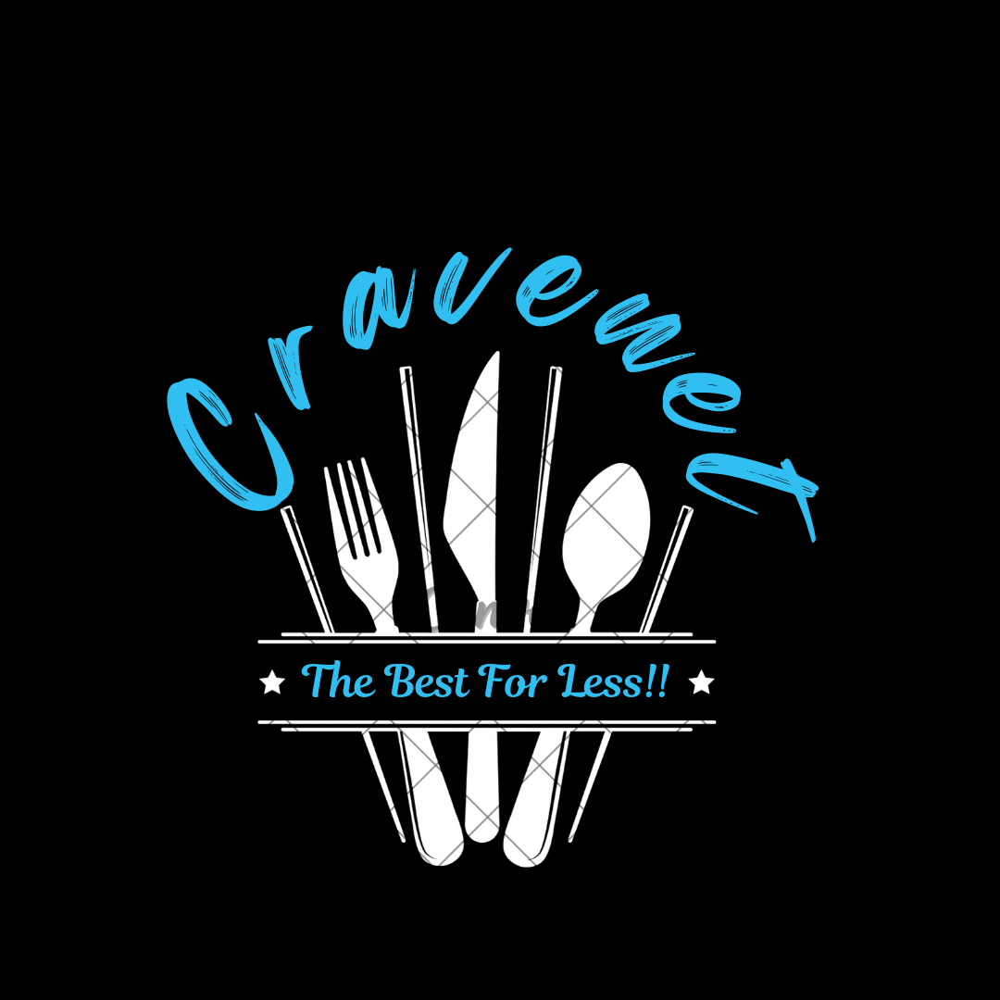

<div align="center">



# CRAVENET

### Smart Food Delivery Price Comparison App

**A full-featured JavaFX desktop application that compares Swiggy & Zomato prices across 36 Mumbai restaurants in real time.**

[](https://www.oracle.com/java/)
[](https://openjfx.io/)
[](https://www.mysql.com/)
[](LICENSE)

</div>

---

## About

**Cravenet** is a complete, multi-screen desktop application built with Java and JavaFX. It is not just a database project — it is a fully functional food ordering companion that:

- Presents a rich graphical user interface with smooth animations and transitions
- Handles real user accounts with OTP-based email registration and login
- Lets users navigate across city locations, dish categories, and restaurant listings
- Fetches live Swiggy and Zomato prices from a MySQL database and presents them side-by-side
- Records placed orders and maintains a full order history per session

The MySQL database is the data backbone of the app — all restaurant data, dish images, prices, and user accounts are stored and queried live as users interact with the application screens.

---

## Application Screens

The app consists of **12 fully implemented JavaFX screens**, each an independent stage:

| Screen | Class | Purpose |
|--------|-------|---------|
| Login | `Login.java` | Username + password login with eye-toggle |
| Registration | `Registration.java` | New account with OTP email verification |
| Location Selection | `LocationSelection.java` | Pick a city to filter restaurants |
| Search Hub | `SearchButton.java` | Central menu — search, browse by dish or restaurant |
| Dish Selection | `DishSelection.java` | Grid of 18 food categories with images |
| Restaurant Selection | `RestaurantSelection.java` | Grid of 36 restaurants with images |
| Restaurant Page | `RestaurantPage.java` | Restaurants that serve a selected dish |
| Restaurant Dishes | `RestaurantDishes.java` | Full dish menu of a selected restaurant |
| Price Comparison (dish flow) | `PriceComparisonPage.java` | Swiggy vs Zomato prices — dish-first flow |
| Price Comparison (restaurant flow) | `RestaurantDishPriceApp.java` | Swiggy vs Zomato prices — restaurant-first flow |
| Order History | `OrderHistory.java` | Complete list of all orders placed in the session |
| Main Entry | `CravenetMain.java` | Application entry point |

---

## Features

| Feature | Description |
|---------|-------------|
| **Secure Registration** | OTP-based email verification on every new account |
| **User Login** | Password field with show/hide toggle |
| **Location Filtering** | City-based restaurant and dish filtering |
| **Browse by Dish** | Select a food category and see every restaurant that serves it |
| **Browse by Restaurant** | Select a restaurant and see its complete dish menu |
| **Live Price Comparison** | Real-time Swiggy vs Zomato prices pulled from the database |
| **Smart Recommendation** | Cheapest platform is highlighted automatically |
| **One-click Order** | Place the order directly from the price screen |
| **Order History** | Every placed order is saved and displayed with timestamp |
| **Animated UI** | Fade and scale transitions between screens |

---

## Tech Stack

```
Language      →  Java 17+
UI Framework  →  JavaFX 23
Database      →  MySQL 8.0  (live queries on every screen)
Email / OTP   →  JavaMail API (SMTP via Gmail)
Build / IDE   →  NetBeans / Eclipse with FX Build
```

---

## Project Structure

```
Cravenet/
│
├── app/                              JavaFX application root
│   ├── src/Cravenet/                 All 12 Java source files
│   │   ├── CravenetMain.java         Entry point
│   │   ├── Login.java                Login screen
│   │   ├── Registration.java         Registration + OTP screen
│   │   ├── LocationSelection.java    City selection screen
│   │   ├── SearchButton.java         Main search / navigation hub
│   │   ├── DishSelection.java        Dish category browser
│   │   ├── RestaurantSelection.java  Restaurant browser
│   │   ├── RestaurantPage.java       Restaurants for a chosen dish
│   │   ├── RestaurantDishes.java     Dishes for a chosen restaurant
│   │   ├── RestaurantDishPriceApp.java  Price comparison (restaurant flow)
│   │   ├── PriceComparisonPage.java     Price comparison (dish flow)
│   │   └── OrderHistory.java         Order history screen
│   ├── bin/                          Compiled class files (gitignored)
│   └── resources/
│       ├── ui/                       UI images — logo, map, back button
│       ├── dishes/                   18 food category images
│       ├── restaurants/              36 restaurant images + Swiggy/Zomato logos
│       └── icons/                    Eye-open / eye-closed icons
│
├── sql/
│   ├── 01_cravenet_database.sql      User auth schema  -- run first
│   └── 02_restaurantes1_data.sql     Restaurant, dish, price & order schema -- run second
│
├── config/
│   └── javafx-vm-args.txt            JavaFX VM module arguments for IDE
│
├── .gitignore
├── LICENSE
├── SETUP.md
└── README.md
```

---

## How the App Works

```
Launch App (CravenetMain)
      │
      ├── Register (new user)
      │     └── Email OTP verification
      │           └── Account created in MySQL (cravenet_database)
      │
      └── Login (existing user)
            └── Credentials checked against MySQL
                  │
                  └── Location Selection
                        │
                        └── Search Hub
                              │
                              ├── Browse by Dish
                              │     └── Select Dish  →  See Restaurants  →  Compare Prices
                              │                                                    │
                              └── Browse by Restaurant                       Place Order
                                    └── Select Restaurant  →  See Dishes         │
                                                               Compare Prices ────┘
                                                                    │
                                                              Order saved to MySQL
                                                                    │
                                                              View Order History
```

Every screen queries the MySQL database live — restaurant lists, dish menus, and prices are all fetched dynamically, not hardcoded.

---

## Database Schema

The database powers every screen of the application:

### `cravenet_database` — User Accounts

```sql
users (id, User_ID, password, email)
```

### `restaurantes1_data` — Application Data

```sql
restaurants     (id, name)
-- Powers the restaurant browser and listing screens

dishes          (id, name, image_path)
-- Powers the dish category browser; image_path loads photos in the UI

restaurant_dish (restaurant_id, dish_id)
-- Junction table: determines which restaurant serves which dish

price_data      (id, dish_id, restaurant_id, swiggy_price, zomato_price)
-- The core of the price comparison screen

orders          (id, dish_name, restaurant_name, platform, order_time)
-- Written to on every order; read back on the Order History screen
```

---

## Setup Guide

### Prerequisites

| Tool | Version | Download |
|------|---------|----------|
| JDK | 17+ | [Oracle JDK](https://www.oracle.com/java/technologies/downloads/) |
| JavaFX SDK | 23 | [openjfx.io](https://openjfx.io/) |
| MySQL Server | 8.0+ | [MySQL](https://dev.mysql.com/downloads/) |
| IDE | Eclipse / NetBeans | Any Java IDE with JavaFX support |

### 1. Clone the Repository

```bash
git clone https://github.com/taksh1507/Cravenet.git
cd Cravenet
```

### 2. Initialize the Databases

Open MySQL Workbench and run both scripts in order:

```sql
source sql/01_cravenet_database.sql
source sql/02_restaurantes1_data.sql
```

> **Note:** Update the `@base` variable in `02_restaurantes1_data.sql` (line ~85) to your local path of `app/resources/dishes/` before running.

### 3. Add JavaFX to Your IDE

Copy the VM arguments from `config/javafx-vm-args.txt` and add them to your IDE's run configuration:

```
--module-path "C:\Path\To\javafx-sdk-23\lib" --add-modules javafx.controls,javafx.graphics,javafx.fxml
```

### 4. (Optional) Enable OTP Registration

In `Registration.java`, fill in real Gmail credentials:

```java
final String username = "your.gmail@gmail.com";
final String password = "your-16-char-app-password";
```

Get an App Password at: [myaccount.google.com/apppasswords](https://myaccount.google.com/apppasswords)

### 5. Run

Set `CravenetMain.java` as the main class and run. Default DB credentials used throughout the app:

```
Host      : localhost:3306
Username  : root
Password  : 518815
```

---

## Supported Cities

| City | Status |
|------|--------|
| Mumbai | Live |
| Delhi | Coming Soon |
| Kolkata | Coming Soon |
| Hyderabad | Coming Soon |
| Pune | Coming Soon |
| Ahmedabad | Coming Soon |
| Surat | Coming Soon |

---

## Contributing

```bash
git checkout -b feature/your-feature-name
git commit -m "feat: describe your change"
git push origin feature/your-feature-name
```

Open a Pull Request and follow conventional commit style (`feat:`, `fix:`, `docs:`, `refactor:`).

---

## License

MIT License — see [LICENSE](LICENSE) for details.

---

## Author

**Taksh** — [@taksh1507](https://github.com/taksh1507)

---

<div align="center">
  <sub>Star this repo if Cravenet helped you save money on food delivery.</sub>
</div>
